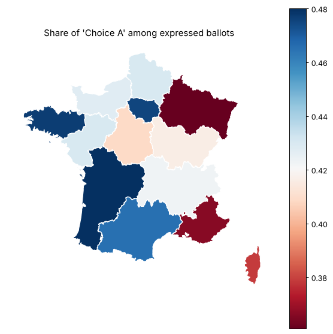

# Data Science Basics

[](https://github.com/Matthis44/data-science-basics/actions/workflows/tests.yml)


Core Python data science skills (NumPy, pandas, scikit-learn) through tested assignments,
two runnable notebooks and a set of algorithm exercises.

| | Content | Highlights |
|---|---|---|
| [`numpy/`](numpy/) | array indexing, numerical series | input validation, `pytest` |
| [`pandas/`](pandas/) | French referendum results, 36,565 towns | multi-table joins, aggregation, choropleth map |
| [`sklearn/`](sklearn/) | k-NN classifier and time-series cross-validator from scratch | scikit-learn API compliant (`check_estimator`) |
| [`pandas_data_basics.ipynb`](pandas_data_basics.ipynb) | pandas tour on real and time-series data | selection, cleaning, merges, rolling volatility, resampling |
| [`sklearn_ml_basics.ipynb`](sklearn_ml_basics.ipynb) | custom estimators and model selection | look-ahead bias in cross-validation, grid search over 12 models |
| [`algorithms/`](algorithms/) | HackerRank problems | hashing, heaps, stacks, dynamic programming |

## Assignments

The three assignments come from the [x-datascience-datacamp](https://github.com/x-datascience-datacamp)
course: the problem statements and the test suites are the course's (BSD licence, see
[`LICENSE-assignments`](LICENSE-assignments)); the solutions are mine.

### NumPy
- Position of the maximum of a 2-D array with `np.argmax` and `np.unravel_index`, with input
  validation.
- Approximation of π with the Wallis product.

### pandas: French referendum analysis



- Join town-level results with the department and region reference tables. The department
  codes are formatted differently in the two sources (`1` vs `01`), so they are normalised
  before the join; overseas territories and citizens abroad are excluded.
- Aggregate the 36,565 towns into 13 regions and compute the share of each answer.
- Join with GeoJSON boundaries and draw the map with `geopandas`.

### scikit-learn: custom estimator and cross-validator
- **`KNearestNeighbors`**: `fit` / `predict` / `score` built on `pairwise_distances` and majority
  voting. It passes scikit-learn's `check_estimator` and gives the same predictions as
  `KNeighborsClassifier` for k = 1, 3, 5, 7.
- **`MonthlySplit`**: a cross-validator that trains on one month and tests on the next, so a
  model is never evaluated on data older than its training set.

## Notebooks

**`pandas_data_basics.ipynb`** — loading and inspection, index manipulation, boolean and
label-based selection, `query`, cleaning (missing values, duplicates, types, binning),
validated merges, named aggregations, pivot tables, and time series on a synthetic price
series: returns, log returns, rolling mean and annualised volatility, monthly resampling.

**`sklearn_ml_basics.ipynb`** — checks the from-scratch k-NN against scikit-learn (accuracy,
decision boundaries, speed); shows on a time series that **shuffled cross-validation makes two
models look as good as a naive forecast, while month-by-month validation reveals they are 2.5 to
3 times worse**; compares 7 classifiers and 5 regressors with pipelines and grid search.

Both notebooks are saved with their outputs and run from top to bottom.

## Run it

```bash
pip install -r requirements.txt
cd numpy && pytest && cd ..
cd pandas && pytest && cd ..
cd sklearn && pytest && cd ..
cd algorithms && pytest && cd ..
jupyter lab   # notebooks
```

Every module is tested and linted (`flake8`) by GitHub Actions on each push.
